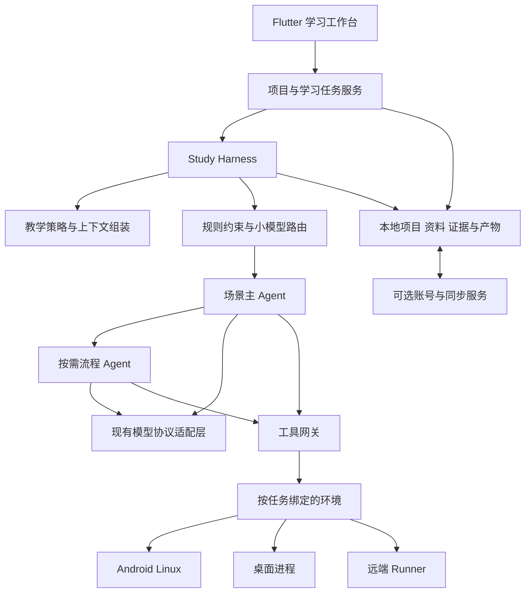

# StudyPi 技术架构 v0.1

日期：2026-10-17。状态：目标架构与实施边界，除明确标注外均为待实现。
首版 Android 优先，Flutter 客户端与桌面复用领域模型。

## 1. 代码审计与复用边界

审计基线：`4588c264fb57aaf455f7e6f9a00b0c06e44cc163`。
结论来自源代码和现有测试，不等于已在手机上实测。

| 能力 | 已读入口 | 当前判断 |
| --- | --- | --- |
| 请求与提示组装 | `lib/features/home/services/message_generation_service.dart` 的请求准备；`message_builder_service.dart::injectSystemPrompt` | 有统一入口，可复用上下文归因和预览；本次已在此接入 Soul |
| 默认学习模式 | `lib/core/services/learning_mode_store.dart`；`instruction_injection_store.dart::_seedDefaultFromLearningMode` | 上游是一段严格不给答案的提示词；本次改成可切换帮助程度的引导策略 |
| 模型协议 | `docs/ai-stream.md`；`lib/core/services/api/` | 流式事件与供应商适配已有边界，路由应复用，不重写协议栈 |
| 工作区 | `lib/core/models/workspace.dart::Workspace` | 仅有 managed/linked 与 hostPath 等本地属性，尚无任务级远端目标 |
| 命令后端 | `lib/core/services/workspace/workspace_runtime.dart::WorkspaceRuntime` | 命令、取消、PTY 已抽象；provider 只持有一个全局 runtime |
| 平台后端 | `workspace_runtime_bootstrap.dart::createWorkspaceStack` | 桌面原生进程、手机平台实现按系统选择，不是用户可并存选择的远端池 |
| 文件工具 | `workspace_tools_service.dart::resolve` 和文件处理方法 | 使用本地路径、Directory/File；远端执行不能只换 shell backend |
| 语音 | `asr_service_options.dart`、`system_asr_service.dart`、`cloud_asr_service.dart`、`sherpa_asr_service.dart` | 已有系统、云端与离线服务；教育场景需统一能力描述与转写资料模型 |
| 用户资料 | `lib/core/providers/user_provider.dart::UserProvider` | 本地名字和头像，不是认证会话或跨设备账户 |
| 模型账号 | `lib/core/services/auth/provider_oauth_service.dart` 等现有模块 | 供应商凭证层与 StudyPi 账号层需要独立 |
| 数据 | `lib/core/database/` 与 `AGENTS.md` | 沿用 Drift；新增业务对象独立建模，不把所有学习记录塞进对话摘要 |

现有材料解析、备份、记忆、MCP、语音、桌面布局与测试是重要资产。
实施时按调用边界逐步接入，每个里程碑保留完整可运行流程。

## 2. 层次

- **客户端**负责阅读、交互、运行状态和本地资料访问。
- **Harness**负责目标、状态机、模型角色、上下文、预算和恢复，避免再堆入 Home 页面控制器。
- **模型适配层**负责协议、流式事件和原生回放，不承载教学状态判断。
- **工具网关**负责能力校验、调用与结果对象；权限在代码和运行环境中落实。
- **环境**负责文件、命令、产物与生命周期；远端任务的权威状态由远端服务维护。
- **身份与同步**服务负责用户、设备与数据所有权，不进入基本离线阅读路径。

首个实现继续使用 Dart/Flutter 现有调用栈。远端 Runner 的语言与认证实现，在 M3 的协议样机和部署约束明确后选定，
不为追求与 Pi 使用同一种语言而复制一套模型协议栈。

## 3. 领域对象

以下是待实现的领域边界，不预先创建大量空类或空数据库表。

| 对象 | 最小字段与关系 | 约束 |
| --- | --- | --- |
| LearningProject | id、ownerScope、目标、材料、会话、任务、归档状态 | 游客可创建，账号加入时显式归属 |
| LearningGoal | 描述、验收表现、期限（可选）、用户背景 | 已知背景复用，空背景不阻挡提问 |
| SourceDocument | 原始文件摘要、名称、版本、格式、导入时间 | 原文与 OCR/解析产物分离 |
| SourceAnchor | documentId、版本、页码/段落/区域/时间范围 | 引用必须能回到对应版本 |
| ResearchClaim | 结论、支持/反对出处、假设与局限 | 引用存在不等于论证成立 |
| LearningEvidence | 概念、任务、作答、提示量、量规、结果、时间 | 不把 AI 自评或用户自述当独立掌握证据 |
| LearningTask / Run | 目标、状态、模型决策、环境、预算、事件游标 | 一个任务可有多次运行，每次都有稳定 ID |
| Artifact | 类型、内容摘要、路径引用、来源任务、复现信息 | 结果可独立查看，不只藏在聊天文本 |
| EnvironmentTarget | id、位置、能力、连接状态、凭证引用 | 不把凭证写进提示词、URL 或普通同步记录 |
| LearnerPreferences | 语言、帮助偏好、已确认目标、用户更正 | 可查看、修改、删除，不做固定能力标签 |

先用项目、材料、锚点和任务关联打通 M1。证据与复习记录跟随实际学习流程增加。
优先复用现有会话和附件存储，业务关系通过独立仓库接口管理。

## 4. 提示词与上下文

目标组装顺序：

1. 版本化 Soul：学习目标、自主性、证据、可验证产物与能力诚实。
2. 场景策略：当前是解释、练习、研究、实验还是复盘。
3. 用户与项目上下文：已知基础、当前任务、必要的学习证据。
4. 按需材料与技能：保留来源 ID，控制体积，不全文重复注入。
5. 实际可用工具与环境能力。
6. 保持有效协议边界的对话与本轮请求。

本次代码只完成第 1 层及现有引导学习卡片；其他既有注入仍沿原调用顺序。
`StudyPrompts.compose` 先放稳定核心，再放解析后的自定义提示；不在数据库中覆写用户配置。
实际组合文本进入 `ContextSource.systemPrompt`，参与现有上下文归因和发送前清理。
XML 标记只帮助组织文本，不构成权限边界；权限必须由工具与服务端强制执行。

以后每次运行保存 `soulVersion`、场景、技能版本、材料版本和路由决策摘要。
压缩时保留目标、结论、未决问题和来源定位，不把模型推测固化成学习者事实。
不同供应商的签名思考块按既有协议作用域处理，跨模型任务包采用可核验摘要和产物引用。

## 5. 路由与分工

路由由确定性能力过滤和小模型判断组成：

1. 用户显式选择、可用凭证、模态、工具支持、环境政策和预算先限制候选。
2. 短小明确请求直接使用当前主模型，避免每一轮都付出额外路由延迟。
3. 复杂或场景变化请求交给小模型生成受 schema 约束的路由建议。
4. 校验候选、任务需求与预算；不接受模型输出的任意 provider、权限或工具。
5. 记录选择理由；低置信、无效输出或超时使用可用主模型承担判断，必要时说明缺失能力。

路由建议包括 `scene`、`requiredCapabilities`、`candidateRole`、`confidence`、`reasonCode`。
置信度是诊断信号，阈值需要通过评估校准，不能当作正确率。
每个模型的能力按供应商配置和兼容测试登记，价格与延迟只是选择因素之一。

| 角色 | 输入 | 输出 | 调用时机 |
| --- | --- | --- | --- |
| 场景主 agent | 用户目标、任务状态、最小必要上下文 | 计划、解释、最终结论与产物 | 每个学习任务有唯一负责者 |
| 材料阅读 | 指定材料与问题 | 摘要、精确出处、证据缺口 | 多份独立资料或长文 |
| 检索 | 研究问题和已有来源 | 候选来源、实际读取证据 | 需要外部证据 |
| 计算/实验 | 方法、数据和环境 | 文件、运行结果、复现条件 | 需要实际验证 |
| 独立复核 | 原问题、依据、待检查产物 | 错误、反例、未验证项 | 复杂推导或重要结论 |
| 学习观察 | 作答、提示记录和量规 | 本次表现证据与建议 | 有真实学习行为时 |

角色不是必须同时存在的常驻 agent。默认限制并发与总调用预算；有明确的独立工作才并行。
不共享无限聊天历史；任务包需要目标、输入、范围、验收、预算、来源引用。
所有结果先带来源与状态返回主 agent，由主任务决定合并和写入。

## 6. 任务执行与恢复

状态机：`queued → running → waiting_for_user / paused / completed / failed / cancelled`。
`waiting_for_user` 收到回复后继续；暂停后从检查点恢复；已完成、失败、取消为该次运行的终态。
重试创建可追踪的新尝试，不覆盖原始失败证据。

事件至少包含 `runId`、`eventId`、`sequence`、`type`、`timestamp` 和业务载荷。
UI 消费事件并更新投影，不以网络连接是否存在推断任务状态。
保存已确认事件游标，重连去重回放；同一个工具调用有稳定 idempotency key。
对于无法幂等的操作，重连先查询实际状态，不能因超时盲目重复执行。

预算包含模型 token/费用上限、工具执行时间、并发、产物空间和重试次数。
部分供应商缺少完整用量时显示估计及缺失项，不假称精确计费。
取消应传播到模型、流程 agent 和可取消的工具，保留已经生成的成果与清楚的终态。

## 7. 手机、桌面与云端环境

需要补齐三层接口：

- **EnvironmentRegistry**：列出目标、探测能力、按任务冻结 `environmentId`。
- **ExecutionBackend**：命令、取消、状态、PTY、输出流和资源约束。
- **WorkspaceFileBackend**：列举、读取、写入、增量修改、上传、下载与元数据。

现有 `WorkspaceRuntime` 可以保留作为本地命令接口；全局 provider 不能再决定所有任务的执行位置。
所有任务入口（交互、定时、MCP STDIO、恢复）都需要从任务绑定解析后端。
远端文件引用使用 `environmentId + workspaceId + relativePath` 或稳定 artifactId，
不能把远端 `/workspace/...` 当成手机上的真实文件路径。

远端 Runner 协议样机至少覆盖：

| 操作 | 内容 | 关键验证 |
| --- | --- | --- |
| capability / health | 协议版本、工具、资源与支持的文件操作 | 不兼容版本明确拒绝 |
| start run | 任务 ID、输入清单、环境模板和预算 | 重复提交不生成两次运行 |
| read events | 从游标读取 SSE 或等价流 | 断网后按序恢复且不重复展示 |
| read/cancel run | 权威状态、取消请求 | 断开连接不等于取消 |
| transfer files | 大小、内容摘要、分块与完成确认 | 传输未完成不能当可用输入 |
| get artifact | 权限检查后的产物下载 | 租户、项目与路径范围隔离 |

优先使用 HTTPS 或 SSH 隧道保护传输，运行服务使用可撤销、限定项目和设备的令牌。
默认隔离工作目录与运行凭证；PRoot 的 Linux 兼容性不能视为云端多租户安全隔离。
共享云端必须另有容器/系统级隔离、资源限制和服务端授权。

环境选择持久化到任务。正在运行的进程不声称可以无损迁移；切换时创建检查点与新的运行尝试，
验证依赖、数据摘要和已完成步骤。手机上的轻量环境不自动下载大模型或大数据集。

参考 Orca 的远端执行与重连体验，但协议和对象围绕学习任务定义。
[Orca SSH 文档](https://www.onorca.dev/docs/ssh)。

## 8. 语音与多模态

保留现有 ASR 实现，增加统一能力描述及带版本的转写片段对象。
每段包含文本、是否 final、音频引用和服务实际提供的时间范围/置信度。
中间文本仅用于预览；最终转写经用户检查后才进入口头理解评价。
数字、公式和专业词标记为可校对片段，用户修订不覆盖原始转写。

输入组件从能力描述选择本地/云端/系统路径。失败时保留文本与音频草稿，允许切换识别服务。
弱网、权限撤回、长静音、蓝牙切换、来电、后台中断和重复结束事件进入测试矩阵。
文本转写评分和声学发音评分属于不同功能，不凭文本假造声学评价。

## 9. 账号、凭证与同步

- 游客身份使用本地稳定 ownerScope；基本项目与材料离线可用。
- StudyPi 账号使用成熟身份协议/实现；客户端支持系统浏览器登录和 PKCE，不自制密码系统。
- 账号、设备、运行主机、模型供应商凭证各自管理，不混用 token。
- token 通过平台安全存储管理；普通项目同步默认不包含供应商密钥。
- 服务器按用户/项目校验访问，每一次文件、事件、运行和删除操作都受约束。

原生端登录遵循系统浏览器与授权码 + PKCE（S256）模式；服务端校验重定向地址和每次登录的关联状态。
依据：[RFC 8252](https://www.rfc-editor.org/rfc/rfc8252)、
[OAuth 安全最佳实践 RFC 9700](https://www.rfc-editor.org/rfc/rfc9700)。

首轮同步采用服务端修订号与客户端变更队列。冲突保留两个版本并提示处理，
不能把两台设备的学习证据按最后写入简单覆盖。
附件按摘要去重，记录删除标记；备份与实时同步是不同机制。
账号退出停止同步并清理凭证；本地资料的保留或清理由明确操作决定。
账号加入前展示待关联项目，用户确认后迁移归属。

账号服务、域名、邮件/第三方登录配置、服务器部署地点与数据保留要求在 M4 进入实作前确定。
端到端加密如果纳入范围，必须另行设计密钥恢复和服务端检索的取舍，不能只把 HTTPS 称作端到端加密。

## 10. 品牌与上游维护

Android 发行标识为 `app.studypi`（已切换 applicationId；namespace 与 Kotlin 包暂保留 Kelivo 名称）。完整切换需统一检查：
Gradle applicationId/namespace、Kotlin/Java 包与 manifest、FileProvider、深链、
原生通道标识、通知、备份目录、升级来源、签名和打包脚本。
Dart 包名可在独立变更中统一替换，避免把发行包名和 Dart import 名称混为一谈。

保留上游来源说明及已有 LICENSE / NOTICE 文件；移植第三方代码时保留对应声明。
origin 指向用户 Fork，upstream 指向 Kelivo。按模块合入上游修复，避免在品牌变更中掺入行为重构。

## 11. 工程验收与学习效果

工程层检查：请求内容、权限作用域、路由能力匹配、引用定位、任务幂等、恢复、数据冲突和跨端状态。
行为层检查：直接讲解、引导切换、纠错、反例、证据与不确定性、学习自主、避免伪造能力。
真实效果需要在自愿参与的学习任务中比较独立表现与迁移情况，不能由提示词单测或模型自评证明。

模型评估记录模型/供应商、提示版本、参数、工具集合、输入、输出、花费、延迟和人工判定。
首批用例见 `evals/study/behavior_cases.json`；至少保留失败样本，再调整策略或路由。
